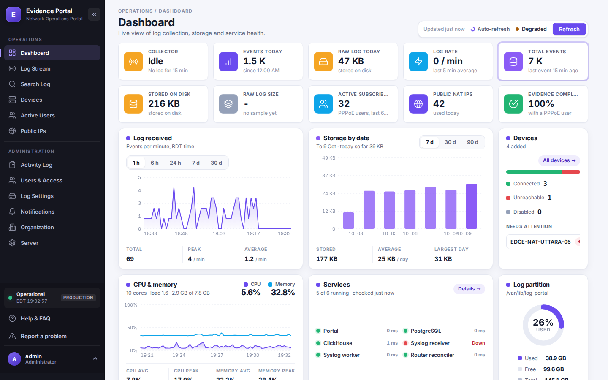
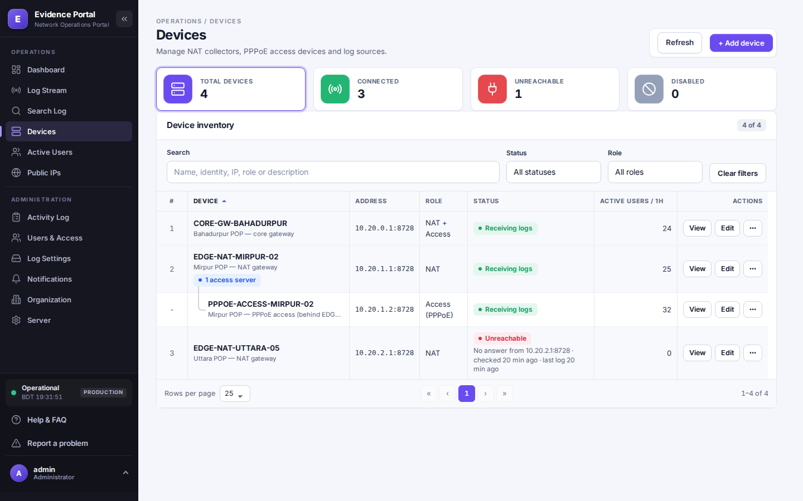
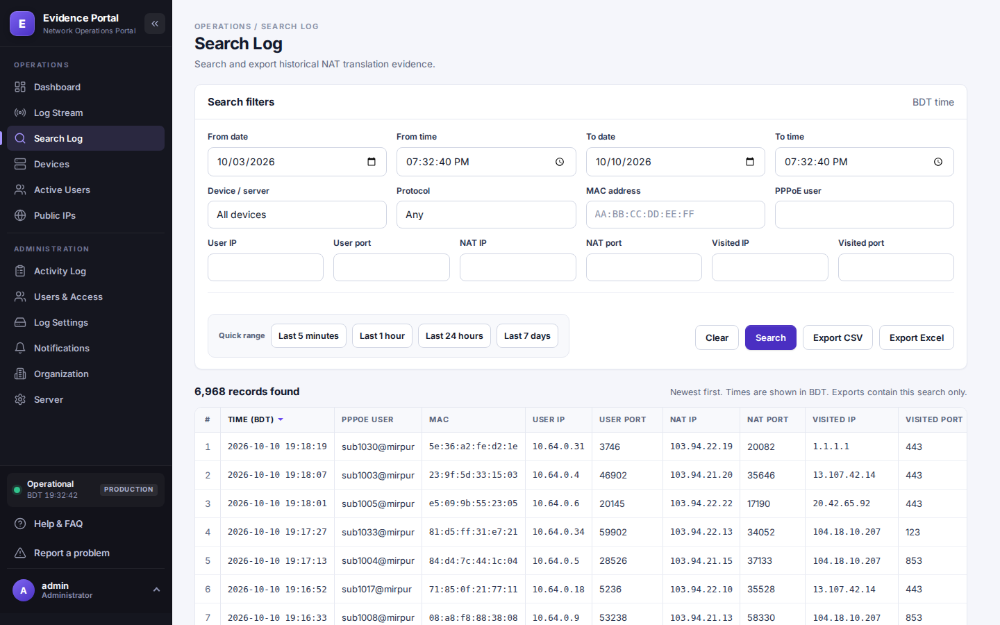
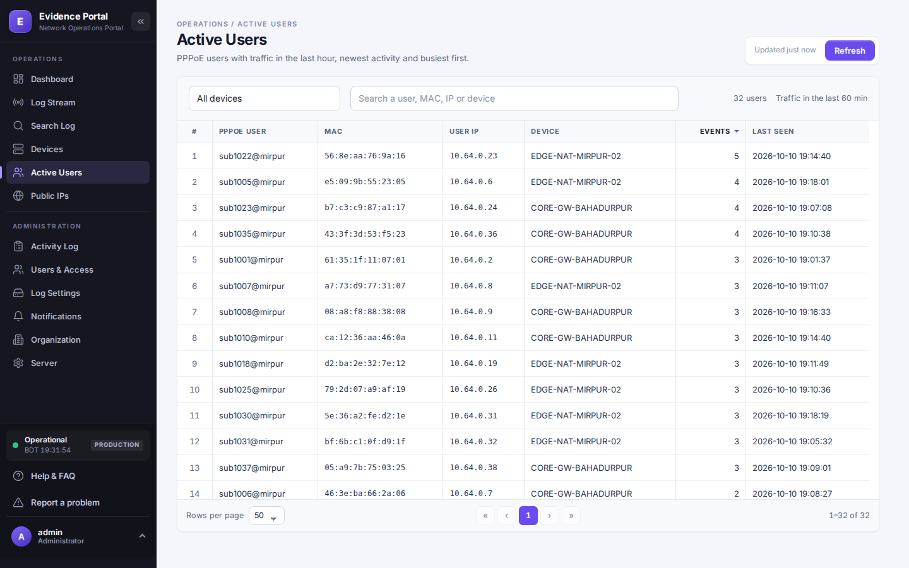
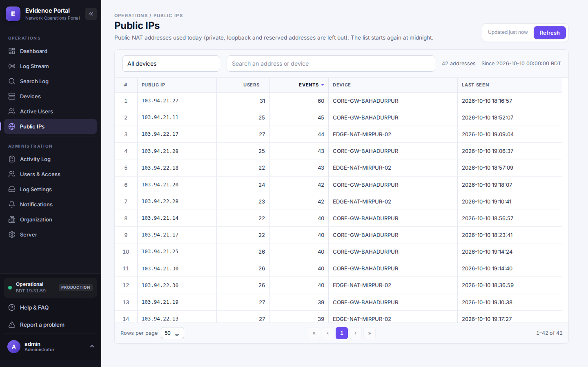

# Openlog

**A NAT and CGNAT log server for MikroTik ISP networks, with PPPoE subscriber attribution.** Openlog receives the logs
your MikroTik routers already produce — including from carrier-grade NAT (CGNAT) pools shared by many subscribers —
matches every connection to the subscriber who made it, and keeps it searchable as evidence. It runs on one Ubuntu
server: portal, PostgreSQL, ClickHouse, syslog-ng and Nginx, installed and updated by one command or from the portal.

**Current version: 1.0.28** | built 2026-10-24T14:05:51Z | [Release notes](CHANGELOG.md) | [All releases](https://github.com/amirulhasanpulok/openlogpro/releases)

This repository holds **releases only**: finished programs, no source code.

## Install in one command

On a clean **Ubuntu 24.04 LTS (x86_64)** server, as root or with `sudo`, with internet access:

```bash
curl -fsSL https://github.com/amirulhasanpulok/openlogpro/releases/latest/download/install.sh | sudo bash
```

The server starts in **evaluation mode** (up to 3 devices, 3 users, 30 days of logs). **A licence belongs to one server,
so you get it after the install:** open **Server Settings > Licence**, send the **Server ID** shown there to your provider, and
paste the licence you receive into the same page. Nothing is restarted.

The installer checks the machine first, installs everything, verifies it, and prints the address and the first
sign-in. It takes about 5 to 10 minutes. Prefer to read the script before running it? See
[Review first](docs/INSTALL.md#32-review-first-install).

## Documentation

| Guide | For |
|---|---|
| [Installation guide](docs/INSTALL.md) | Requirements, network and firewall, install options, first sign-in, licence, HTTPS, hardening, file and service reference |
| [Connect MikroTik routers](docs/ROUTERS.md) | The API account, the logging commands (RouterOS 7 and 6), verifying that logs arrive |
| [Updates and rollback](docs/UPGRADE.md) | Updating from the portal or the command line, licence coverage, going back to an earlier version |
| [Troubleshooting](docs/TROUBLESHOOTING.md) | Installer blockers, sign-in, licence, routers that send no logs, failed updates, what to send to support |
| [Release notes](CHANGELOG.md) | What changed in every version |
| [Licence agreement (EULA)](docs/EULA.md) | The terms of use. The first administrator is asked to accept it when signing in |

## What you can do with it

Openlog turns the NAT and PPPoE logs your MikroTik routers already produce into evidence you can actually search:
"who was using public IP 103.x.x.x on port 35646 at 19:18 BDT on 10 October" answered in seconds, with the matching
subscriber account, MAC address and device — the kind of request a regulator, a law-enforcement notice or an abuse
complaint asks for, backed by data you keep yourself instead of raw router logs you have to grep by hand.

**Dashboard — the whole deployment at a glance.** Log intake rate, storage used per day, CPU/memory/disk of the
server itself, every configured service (portal, PostgreSQL, ClickHouse, syslog worker, router reconciler) with its
own status, and which devices need attention — all on one page, auto-refreshing.



**Devices — every router you collect from.** Add a MikroTik by its API address; the portal connects, reads back its
identity and only then lets you save it, so nothing is logged from a device you have not actually verified. A NAT
gateway and the PPPoE access server behind it are linked, so the portal can tell you which subscriber was behind
which NAT translation even though the two events come from two different routers. Connected, unreachable and
disabled devices are all visible at a glance, with a live count of active users on each.



**Search Log — the evidence itself.** Filter NAT translation records by any combination of date/time range, device,
protocol, MAC address, PPPoE username, internal IP and port, translated (NAT) IP and port, or the destination IP and
port that was visited. Results are exportable to CSV or Excel, scoped to exactly the search you ran, ready to hand
over as evidence.



**Active Users — who is online right now.** Every PPPoE subscriber with traffic in the last hour, their MAC address,
current IP, which device they are attached to, and how recently they were last seen — searchable by user, MAC, IP or
device.



**Public IPs — your CGNAT/NAT pool from the outside in.** Every public IP your routers have translated traffic through
today, how many distinct subscribers shared it, how many events, and which device issued it — useful for spotting a
pool that is running hot or answering "who else was behind this IP at the same time" directly.



**Everything else that matters for evidence you can stand behind:**

- **180 days of searchable history** by default, kept in ClickHouse, partitioned by day and automatically expired —
  no manual log rotation to get wrong.
- **Role-based access** under Users & Access, so who can search, export or change settings is controlled per person,
  with every sign-in and change recorded in the Activity Log.
- **Licensing bound to the server itself** (Server ID: machine, hardware and network card), so a licence cannot be
  copied to another box; Server Settings > Licence shows exactly what plan, device/user limits and update coverage are active.
- **Signed, one-command updates** from the portal or the command line, with the last releases kept so you can go
  back if an update ever causes a problem.
- **Report a problem**, built into the sidebar, sends a reference number and the server's technical details straight
  to the provider — never your customers' data, never routed through the organization's own support inbox.

## At a glance

| | |
|---|---|
| Platform | Ubuntu 24.04 LTS, x86_64, systemd. 2 CPU cores or more, 4 GiB RAM or more, 4 GiB free disk to install (20 GiB or more advised; evidence grows with traffic) |
| Ports | In: 80 and 443 (portal), 514 UDP and TCP (routers' logs; changeable). Out: GitHub and the package mirrors for install and updates, and each router's API port |
| Licence | Signed licence tied to one server (its Server ID: machine, hardware and network card); subscription or perpetual. Evaluation mode without one |
| Integrity | Every release is signed. The installer and the updater refuse a release whose signature does not verify |
| Updates | From **Server Settings > Updates**, or `sudo /usr/local/lib/openlog/update-log-server`. The last releases are kept, so you can go back |
| Support | **Report a problem** in the portal sidebar creates a report with a reference number and the server's technical details, without passwords or logs |

## What is new in 1.0.28

- Hardening: the database migrations that run on every startup now take a brief lock first, so
  two processes can never race to create the same table/trigger for the first time. No change for
  a normal single-server install (the lock is acquired and released instantly); this only matters
  for a future clustered deployment, which cannot start safely without it.
